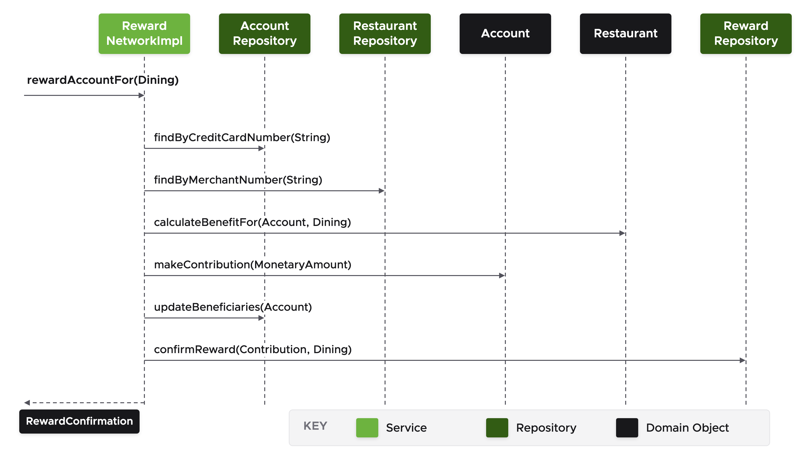
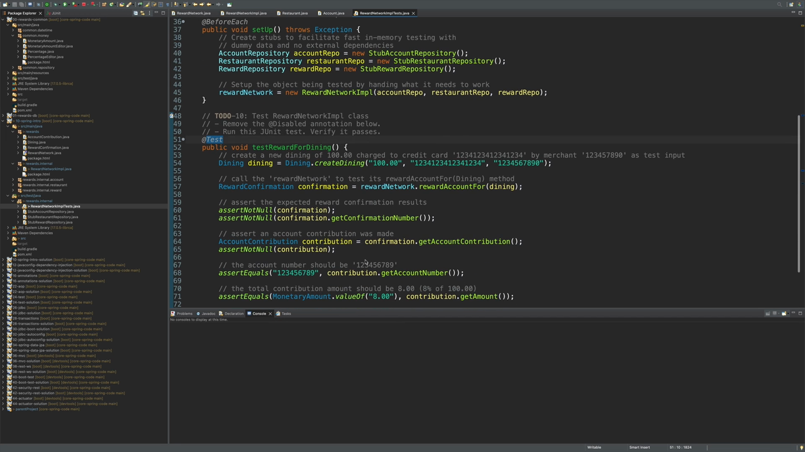

## What you'll get out of this lesson

This lesson walks through the course's first hands-on lab. No Spring is used yet — the goal is purely to get comfortable with the environment and the domain model you'll be building on for the rest of the course. By the end, you should be able to:

- Describe the reward network application's domain model and the components that make it up
- Trace how `RewardNetworkImpl.rewardAccountFor(...)` delegates across the account, restaurant, and reward repositories to do its work
- Implement a method by following a sequence diagram, and verify it with an existing unit test

## The scenario

This lab uses project **10, spring-intro**. You won't be using Spring at all in this lab — instead, you'll get familiar with the reward network application, the project you'll keep extending throughout the rest of this course.

## Reviewing the domain and dependencies

The first step is to review the reward reference domain material (found in the "Introduction to the Spring Professional Learning Path" reference), which gives an in-depth explanation of the domain model, its components, and the database schema. It's worth working through if you haven't already, since everything in this lab builds on it.

Next, the lab has you inspect the project's dependencies (via Maven or Gradle — either works identically here). You'll see familiar names: Spring, Spring JDBC, JUnit Jupiter, and the Spring Boot starter dependencies. One detail worth calling out: even though the project pulls in Spring Boot's *starter* dependencies to manage versions conveniently, this lab does **not** use Spring Boot's auto-configuration — you're working with plain, vanilla Spring throughout.

The project also includes a shared module called `00-rewards-common`, containing types used across all the other lab projects — things related to date and time, or money, like `MonetaryAmount` and `Percentage`. Several domain model methods return these shared types, which is why they've been pulled out into their own project rather than duplicated everywhere.

## Reviewing the application domain and API

The central interface in the project is `RewardNetwork`, with a corresponding implementation, `RewardNetworkImpl`. `RewardNetwork` exposes a single method:

```java
RewardConfirmation rewardAccountFor(Dining dining);
```

You pass in a `Dining`, and get back a `RewardConfirmation`. The implementation, `RewardNetworkImpl`, lives under the `rewards.internal` package.

Looking at that implementation, `rewardAccountFor` delegates to a set of repositories — an `AccountRepository`, a `RestaurantRepository`, and a `RewardRepository` — all of which are passed in through the constructor. Notice there's no `new` operator anywhere: these dependencies are meant to be supplied from the outside, by a container, even though this particular lab doesn't wire one up. At the start of the lab, `rewardAccountFor` is just an empty method — implementing it is the main task ahead.

## The sequence diagram

Before writing any code, the lab walks through the sequence diagram `rewardAccountFor` needs to implement:



Reading the diagram left to right:

1. Call `accountRepository.findByCreditCardNumber(...)` to load the `Account` from the dining's credit card number.
2. Call `restaurantRepository.findByMerchantNumber(...)` to load the `Restaurant` from the dining's merchant number.
3. Call `restaurant.calculateBenefitFor(account, dining)` to get back a `MonetaryAmount` — the benefit earned.
4. Call `account.makeContribution(amount)` using that monetary amount, which returns an `AccountContribution`.
5. Call `accountRepository.updateBeneficiaries(account)` to persist the updated beneficiaries on that account.
6. Call `rewardRepository.confirmReward(contribution, dining)`, which returns the `RewardConfirmation` — the same object `rewardAccountFor` needs to return.

As the lab instructions note, you shouldn't need the `new` operator anywhere in this method — every object you need is handed back by one of these calls; the diagram just doesn't show what each call returns along the way.

## Writing the implementation

Following the diagram step by step, the completed method looks like this:

```java
public RewardConfirmation rewardAccountFor(Dining dining) {
    Account account = accountRepository.findByCreditCardNumber(dining.getCreditCardNumber());
    Restaurant restaurant = restaurantRepository.findByMerchantNumber(dining.getMerchantNumber());

    MonetaryAmount amount = restaurant.calculateBenefitFor(account, dining);
    AccountContribution contribution = account.makeContribution(amount);

    accountRepository.updateBeneficiaries(account);

    return rewardRepository.confirmReward(contribution, dining);
}
```

The final piece — returning the `RewardConfirmation` — comes directly from what `confirmReward` hands back, replacing the placeholder `null` return that was there at the start.

## Testing the implementation

With the method written, the lab has you verify it using an existing test class, `RewardNetworkImplTest`, found under `src/test/java` in the `rewards.internal` package.



The test's `setUp()` method creates stub repositories for the account, restaurant, and reward repositories — no framework, no external dependencies, just plain Java stubs with canned test data — and constructs a `RewardNetworkImpl` directly from them:

```java
@BeforeEach
public void setUp() throws Exception {
    // Create stubs to facilitate fast in-memory testing with dummy data and no external dependencies
    AccountRepository accountRepo = new StubAccountRepository();
    RestaurantRepository restaurantRepo = new StubRestaurantRepository();
    RewardRepository rewardRepo = new StubRewardRepository();

    // Setup the object being tested by handing it what it needs to work
    rewardNetwork = new RewardNetworkImpl(accountRepo, restaurantRepo, rewardRepo);
}
```

This is the same pattern from the "The Dependency Injection (DI) Container" lesson: because `RewardNetworkImpl` only depends on repository interfaces, a unit test can hand it stub implementations directly, with no container involved at all.

The actual test method, `testRewardForDining`, is initially marked `@Disabled`. Removing that annotation and running the test exercises the method you just wrote: it creates a `Dining` for a $100.00 charge, calls `rewardAccountFor`, and asserts that the returned `RewardConfirmation` and its contribution details are correct — including that the contribution amount comes out to $8.00 (8% of $100.00). Running it should produce a green bar, confirming the implementation matches the sequence diagram.

## Recap

- This lab used the reward network application without any Spring involved — pure Java objects, wired together by hand or via stubs.
- `RewardNetworkImpl.rewardAccountFor(...)` delegates to the account, restaurant, and reward repositories in a specific sequence, defined by the lab's sequence diagram.
- Because the implementation depends only on repository interfaces, `RewardNetworkImplTest` can supply stub implementations directly in its `setUp()` method — no container required.
- Removing `@Disabled` and running `testRewardForDining` is how you verify your implementation actually matches the expected behavior.

## Check your understanding

1. In what order does `rewardAccountFor` call the account repository, the restaurant, and the reward repository, and what does each call return?
2. Why doesn't the implementation of `rewardAccountFor` need to use the `new` operator anywhere?
3. Why is `RewardNetworkImplTest` able to test `RewardNetworkImpl` without any Spring container present?

In the next lesson, **Packaging and Integration Testing**, you'll shift gears to look at how Spring Boot's tooling can package an application and support integration testing.
