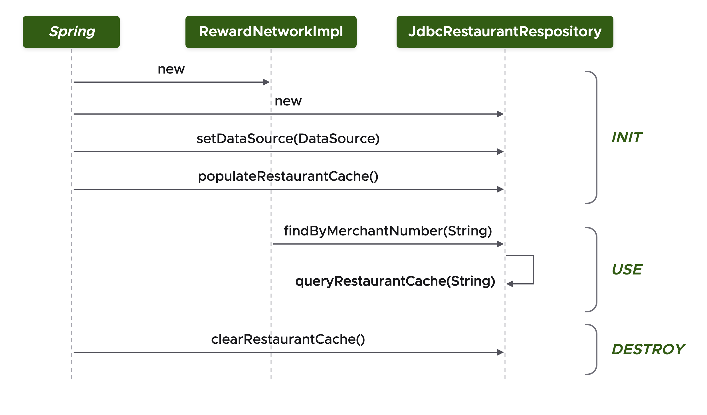
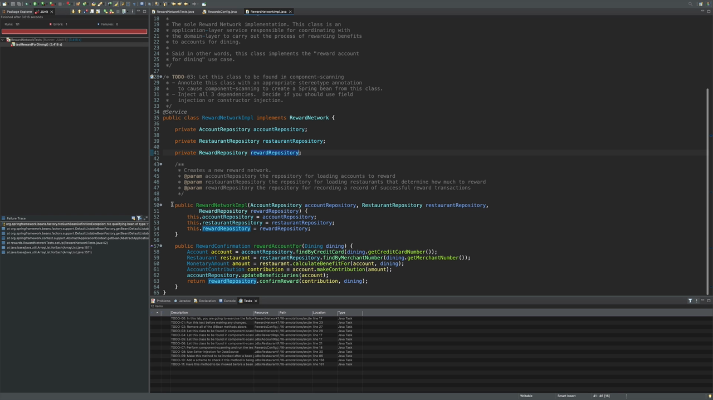

## What you'll get out of this lesson

This lesson walks through a hands-on lab that takes the previous lab's Java-config-based Rewards application and re-configures it entirely with annotations. By the end, you should be able to:

- Refactor an existing Java-config setup into annotation-based configuration, class by class
- Choose between constructor injection, setter injection, and `@Autowired` deliberately, rather than by default
- Wire `@PostConstruct` and `@PreDestroy` into a real repository's cache lifecycle and verify the callbacks actually fire

## The scenario

This lab picks up exactly where the previous lab on Java configuration left off: a fully functional Rewards application, with JDBC-backed repository implementations connecting to an in-memory HSQLDB database. The starting project is number 16, "annotations."

One component in particular needs more than a straightforward annotation swap: `JdbcRestaurantRepository` has to populate a restaurant cache during initialization and clear it during destruction. Working out how to trigger that at the right moment in the bean lifecycle — using the annotations from the "Adding Startup and Shutdown Behaviors" and "Annotation-based Configuration" lessons — is the throughline of the lab.

The lab's own sequence diagram lays out the shape of the problem: during **INIT**, Spring creates the repository, calls `setDataSource(DataSource)`, and then `populateRestaurantCache()` needs to run. During **USE**, methods like `findByMerchantNumber(String)` read from that cache via `queryRestaurantCache(String)`. During **DESTROY**, `clearRestaurantCache()` needs to run before the bean goes away.

## To-do 1: Confirm the starting point works

Before making any changes, the lab runs the existing `RewardNetworkTests` test class as-is, using the Java configuration left over from the previous lab. It passes — green bar — confirming the baseline is solid before refactoring begins.

## To-do 2: Strip out the Java configuration

Next, every `@Bean` method in the configuration class gets deleted, along with the constructor that wired in the `DataSource` — none of it is needed anymore, since annotations are about to take over. With the configuration class left completely empty, re-running the test produces a red bar, and specifically a `NoSuchBeanDefinitionException`: the test infrastructure config still imports the (now-empty) rewards config, so there's no `RewardNetwork` bean anywhere in the application context. This is expected — it confirms the old configuration really has been removed, and sets up the rest of the lab.

## To-do 3: Annotate `RewardNetworkImpl`

`RewardNetworkImpl` sits in the service layer, so it gets annotated `@Service` — one of the stereotype annotations from the "Stereotype and Meta Annotations" lesson — to make it discoverable by component scanning.

`RewardNetworkImpl` depends on an `AccountRepository`, a `RestaurantRepository`, and a `RewardRepository`, all supplied through a single constructor. Since there's only one constructor, `@Autowired` isn't required here — Spring uses it automatically, exactly as covered in the "Configuration Choices" lesson.

## To-dos 4–6: Annotate the repositories

Each JDBC repository implementation belongs to the data access layer, so each gets `@Repository` rather than `@Service` — a different stereotype annotation that carries the same component-scanning behavior but documents the class's role more precisely (`@Component` would technically also work, but `@Repository` is more meaningful).

- **`JdbcRewardRepository`** and **`JdbcAccountRepository`** each need their `DataSource` injected. Since neither has a constructor that takes one, `@Autowired` goes directly on the existing `setDataSource(...)` method — setter injection.
- **`JdbcRestaurantRepository`** is different: it has two constructors, and the one that takes a `DataSource` is also where the restaurant cache needs to get populated. Because there's more than one constructor, `@Autowired` has to explicitly mark the one Spring should use — exactly the "more than one constructor" case from the "Configuration Choices" lesson where the annotation isn't optional.

## To-do 7: Add component scanning

Annotations alone don't do anything — they're just labels until something actually scans for them. The configuration class needs `@ComponentScan` with an explicit base package. Left unspecified, component scanning would start from the package the configuration class itself lives in — here, a `config` package with no repositories or services underneath it at all. All the actual components live under `rewards.internal`, so that's the base package the lab adds. Re-running the test after this change produces a green bar — everything is now being found and wired through annotations instead of explicit `@Bean` methods.

## To-do 8: Move the `DataSource` injection to a setter

The lab then deliberately changes tack on `JdbcRestaurantRepository`: instead of injecting the `DataSource` through the constructor, `@Autowired` moves onto a setter method instead. That means Spring now uses the default no-argument constructor, and the constructor logic that used to populate the cache no longer runs at all.

Re-running the test at this point fails with a `NullPointerException` — the cache was never populated, because the code that used to do it lived in a constructor that Spring no longer calls.

## To-do 9: Fix it with `@PostConstruct`

The fix is exactly the lifecycle annotation from the "Adding Startup and Shutdown Behaviors" lesson: annotate `populateRestaurantCache()` with `@PostConstruct`. Since `@PostConstruct` methods run only after all dependency injection (constructor and setter) has completed, the `DataSource` is guaranteed to already be set by the time the cache gets populated. Re-running the test produces a green bar again — proof that `@PostConstruct` fired at exactly the right moment.

## To-dos 10–11: Clear the cache with `@PreDestroy`

The mirror-image problem: `clearRestaurantCache()` needs to run when the application shuts down. A `System.out.println` gets added inside that method first, purely so its execution is visible in the console — then the method is annotated `@PreDestroy`. Re-running the test and inspecting the console confirms the cache-clearing message appears as the very last line of output, proving the destroy callback fired correctly when the context closed.

## Recap

- Migrating from Java configuration to annotations is mostly a mechanical, class-by-class process: replace each `@Bean` method with a stereotype annotation (`@Service`, `@Repository`, and so on) directly on the implementing class.
- Whether `@Autowired` goes on a constructor, a setter, or nowhere at all depends entirely on how many constructors a class has and where the dependency actually needs to land.
- `@ComponentScan` needs an explicit base package whenever your configuration class doesn't already sit above your components in the package hierarchy — otherwise nothing gets scanned.
- `@PostConstruct` and `@PreDestroy` are the right tools whenever a bean needs to do setup or cleanup work that depends on injected dependencies already being in place.
- Watching a test go red, then green, then red again is a genuinely useful technique for confirming that a lifecycle callback is actually firing where you think it is — rather than just assuming it.

## Check your understanding

1. Why did removing the `@Bean` methods in to-do 2 cause a `NoSuchBeanDefinitionException` rather than a compilation error?
2. In to-do 8, moving the `DataSource` injection from the constructor to a setter broke the cache population. Why exactly — and what does that tell you about when `@PostConstruct` runs relative to setter injection?
3. Why did `JdbcRestaurantRepository` need `@Autowired` explicitly on one of its constructors, while `RewardNetworkImpl` didn't need it at all?

With annotation-based configuration now fully exercised, the "Initialization Phase (Part 1)" lesson turns to the bean lifecycle itself, starting with the initialization phase.
