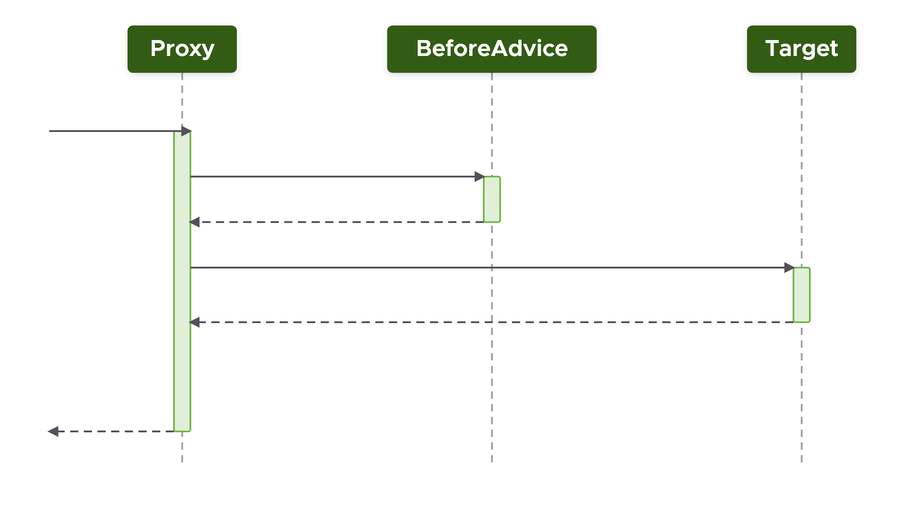
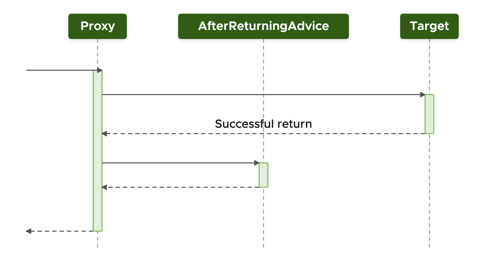
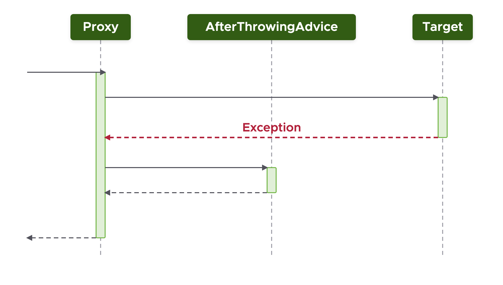
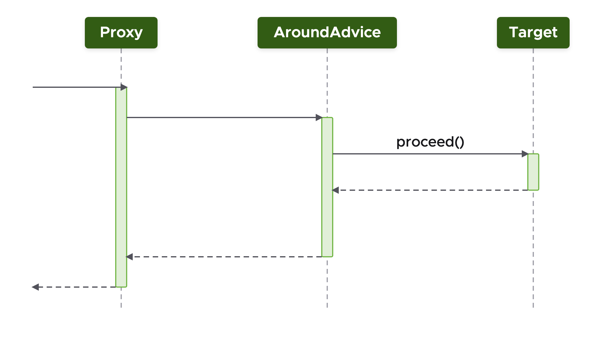

## What you'll get out of this lesson

By the end of this lesson, you should be able to:

- Name the five advice types Spring AOP supports and explain when each one runs relative to the target method
- Read and write the `@Before`, `@AfterReturning`, `@AfterThrowing`, `@After`, and `@Around` annotations
- Explain the extra arguments each advice type gives you access to (the return value, the thrown exception, or the ability to proceed to the target yourself)
- Recognize why `@Around` advice is the most powerful but also the most dangerous of the five
- List Spring AOP's key limitations and explain why they exist

## One advice type down, four to go

In the AOP quick start (the "Core AOP Concepts and Quick Start" lesson), you already saw one advice type in action: **before advice**. But before advice is just one of five ways to hook your cross-cutting logic into a target method's execution. This lesson walks through all five, in order of how they relate to the target's execution: before, after returning, after throwing, after, and around.

## Before advice: a recap

With before advice, the proxy delegates to your advice *before* delegating to the target.



Because your advice code runs first, you can do anything you want ahead of the business logic — including preventing the target from ever running. If your advice throws an exception, the target is never called. That makes before advice a natural fit for security checks: throw an exception if the caller doesn't have the rights to invoke that method, and the target method is skipped entirely.

Here's the example from the quick start, revisited: a requirement to track calls to all setter methods.

```java
@Aspect
@Component
public class PropertyChangeTracker {

    private Logger logger = Logger.getLogger(getClass());

    @Before("execution(void set*(*))")
    public void trackChange() {
        logger.info("Property about to change...");
    }
}
```

The class is annotated with `@Aspect` (an AspectJ annotation, not a Spring one) and `@Component` (so Spring picks it up as a managed bean). The method annotated with `@Before` is the advice itself — don't confuse this with JUnit 4's own `@Before` annotation; this one comes from AspectJ and it's what actually tells Spring which advice type you're implementing. The string inside `@Before` is the pointcut expression you've already seen: it selects every method starting with `set` that takes exactly one argument and returns `void`.

## After returning advice

The next advice type runs the other way around: the proxy delegates to the target *first*, and only calls your advice afterward — and only if the target actually returns successfully (no exception).



Because the advice runs after a successful return, it has access to more information than before advice does: not just the join point's context, but also the value the target returned.

Suppose the requirement is to audit all operations in the `service` package that return a `Reward` object:

```java
@AfterReturning(value = "execution(* service..*.*(..))",
                 returning = "reward")
public void audit(JoinPoint jp, Reward reward) {
    auditService.logEvent(jp.getSignature() +
        " returns the following reward object: " + reward.toString());
}
```

Notice there are now two arguments on the annotation. `value` defines the pointcut — here, it matches any method with zero or more arguments in any class in any package starting with `service`, returning any type. On its own, that pointcut is too broad: it would match anything, regardless of what's returned, but the actual requirement only cares about methods that return a `Reward`. That's what the second argument, `returning`, is for. It names one of the advice method's own arguments — here, `reward` — and Spring uses that name to do two things: it narrows the match so the advice only fires when the target's return type is assignable to that argument's type, and it binds the actual returned object to that argument so your advice code can use it. In other words, `returning` makes the advice match on **both** the pointcut expression and the return type, and it hands you a reference to what was actually returned.

## After throwing advice

As the name suggests, this advice type only executes if the target throws an exception. The proxy delegates to the target; if the target throws, the proxy delegates to the advice, handing it the exception that was thrown.



This is useful for implementing exception handling — for example, sending an email every time a repository class throws a `DataAccessException`:

```java
@AfterThrowing(value = "execution(* *..Repository.*(..))", throwing = "e")
public void report(JoinPoint jp, DataAccessException e) {
    mailService.emailFailure("Exception in repository", jp, e);
}
```

The `value` pointcut selects any method with zero or more arguments in a class called `Repository`, in any package, returning any type — deliberately not mentioning the exception type at all. That's what the second argument, `throwing`, is for: like `returning`, it names one of the advice method's arguments (here, `e`, typed as `DataAccessException`) and Spring uses that type to further restrict the match — the advice only fires if the exception thrown is that type (or a subtype).

Note that this advice doesn't stop the exception from propagating on its own — it behaves like an interceptor that can react to the exception, but the original caller will still receive the `DataAccessException` unless you do something about it. And you can: because the advice method itself can throw, a common technique is **exception translation** — wrapping a low-level, framework-specific exception in your own business exception:

```java
@AfterThrowing(value = "execution(* *..Repository.*(..))", throwing = "e")
public void report(JoinPoint jp, DataAccessException e) {
    mailService.emailFailure("Exception in repository", jp, e);
    throw new RewardsException(e);
}
```

With this in place, the caller receives a `RewardsException` instead of the original `DataAccessException` — either the original exception propagates, or a new one thrown from the advice does, depending on what your advice code decides to do.

## After advice

After advice runs after the target completes, *regardless* of whether it returned successfully or threw an exception — it doesn't distinguish between the two outcomes the way the previous two advice types do.

Suppose the requirement is to track calls to all update methods:

```java
@Aspect
@Component
public class PropertyChangeTracker {

    private Logger logger = Logger.getLogger(getClass());

    @After("execution(void update*(*))")
    public void trackUpdate() {
        logger.info("An update has been attempted...");
    }
}
```

The `@After` annotation marks this as after advice, and the pointcut matches any update method, on any class, taking zero or more arguments and returning `void` — no fully qualified class name required, so this applies to any matching method on any Spring-managed bean in the application context.

## Around advice: the most powerful, and the most dangerous

The last advice type is around advice — and it's a different shape entirely from the other four. With before, after returning, after throwing, and after, the **proxy** is always responsible for delegating to both the advice and the target. With around advice, the proxy only delegates to your advice — and *you* are responsible for delegating to the target yourself, using a `proceed()` method.



Because you control that `proceed()` call, around advice can run code both before and after the target — which technically means you could implement any of the other four advice types using nothing but `@Around`. But that flexibility comes with a real risk: if you forget to call `proceed()`, the target method is never executed at all.

Here's an example implementing a simple cache for cacheable services:

```java
@Around("execution(* example.Cacheable * rewards.service..*.*(..))")
public Object cache(ProceedingJoinPoint point) throws Throwable {
    Object value = cacheStore.get(CacheUtils.toKey(point));
    if (value != null) return value;   // Value exists? If so just return it

    value = point.proceed();           // Proceed only if not already cached
    cacheStore.put(CacheUtils.toKey(point), value);
    return value;                      // Cache values returned by cacheable services
}
```

The pointcut matches any method, with zero or more arguments, on any class inside the `rewards.service` package annotated with `@Cacheable` — a custom annotation of your own, matched the same way you'd match any other. The method parameter is typed as `ProceedingJoinPoint` rather than the plain `JoinPoint` you've seen so far — it carries the same context information, but it also exposes the `proceed()` method that delegates to the target.

The logic itself: build a cache key from the join point, and if a value is already cached, return it directly — the target is never called at all in that case. Otherwise, call `point.proceed()`, which runs the target and returns whatever it returned; cache that value, then return it to the proxy. Because you're building the return value yourself, around advice also lets you completely change the return type coming back from the target, or wrap the `proceed()` call in a try/catch block to intercept and suppress exceptions. That's a lot of power — and, as mentioned, a lot of responsibility, since nothing forces you to call `proceed()` at all.

## Limitations of Spring AOP

Having seen all five advice types, it's worth being explicit about what Spring AOP *can't* do:

- **It can only advise non-private methods.** This matters especially when working through interfaces.
- **It can only apply aspects to Spring-managed beans.** Spring AOP works by creating proxies during the bean post-processor phase of the bean lifecycle (bean lifecycle territory), and a bean post-processor only ever sees beans that are already part of the application context. If your object isn't a Spring bean, there's no way for a proxy to be created around it, so it can never be advised.
- **Internal (self-invoking) calls aren't advised.** If a method inside your target class calls another method on `this` directly, that call never goes back through the proxy — so it never gets advised, even if the inner method would otherwise match your pointcut.

These limitations exist because Spring AOP is proxy-based. A different technology, AspectJ, works by weaving advice directly into compiled bytecode rather than wrapping objects in proxies, and it doesn't share any of these three limitations — it can advise private methods, non-Spring-managed objects, and internal calls alike. Still, in the large majority of real-world cases, Spring AOP's proxy-based approach is more than sufficient.

## New since this course was recorded: built-in resilience, built on exactly this proxy mechanism

Everything in this module — the five advice types, the proxy that carries them, the limitations just covered — has, until now, mostly been in service of examples you'd write yourself (a logging aspect, a security check). **Spring Framework 7.0** ships two genuinely new, ready-made aspects built with this *exact* mechanism, solving problems every real application eventually runs into:

- **`@Retryable`** — annotate a method, and Spring wraps it in a proxy that automatically retries it on failure, according to whatever retry policy you configure (how many attempts, what backoff between them, which exceptions count as retryable). As of Framework 7, it even works on methods with reactive return types.
- **`@ConcurrencyLimit`** — annotate a method, and the proxy caps how many calls can be executing it concurrently, queuing or rejecting the rest. Particularly relevant when using virtual threads, where it's easy to accidentally let far more concurrent calls through to a limited downstream resource (a database, a rate-limited external API) than it can actually handle.

Recognize the pattern? This is the *exact same idea* as `@Transactional`, which you'll meet properly in the transaction management module later in this course: an annotation triggers proxy creation, and the proxy wraps your method call in cross-cutting logic — begin/commit for `@Transactional`, retry-on-failure for `@Retryable`, a concurrency gate for `@ConcurrencyLimit` — without your business logic itself ever needing to know any of that is happening. Previously, retry logic like this required a separate library (Spring Retry); it's now a first-class part of the framework, built with the AOP proxy mechanism this entire module has been teaching.

## Recap

- **Before** advice runs before the target; throwing an exception here prevents the target from executing at all — useful for security checks.
- **After returning** advice runs only after a successful return, and its `returning` attribute both narrows the match to a specific return type and binds the returned value into your advice method.
- **After throwing** advice runs only when the target throws, and its `throwing` attribute both narrows the match to a specific exception type and binds the thrown exception — useful for exception handling and exception translation.
- **After** advice runs regardless of outcome — success or exception.
- **Around** advice is the odd one out: the proxy delegates only to your advice, and you must call `proceed()` yourself to reach the target. This gives you full control (changing return values, suppressing exceptions) but real risk (forgetting to call `proceed()` skips the target entirely).
- Spring AOP's proxy-based design means it can only advise non-private methods on Spring-managed beans, and it can't advise internal (self-invoking) calls — limitations AspectJ's bytecode-weaving approach doesn't share.

## Check your understanding

1. Why does `@AfterReturning`'s `returning` attribute need to name one of the advice method's own arguments, rather than just specifying a type directly?
2. If you want to both log an exception *and* let the original caller still receive it unchanged, which advice type would you use, and what would you avoid doing inside it?
3. Why is it possible, in principle, to implement before, after returning, after throwing, and after advice all using nothing but `@Around`? What's the trade-off?

That closes out the AOP module — the next lesson puts everything from the last few lessons into practice in a hands-on lab.
