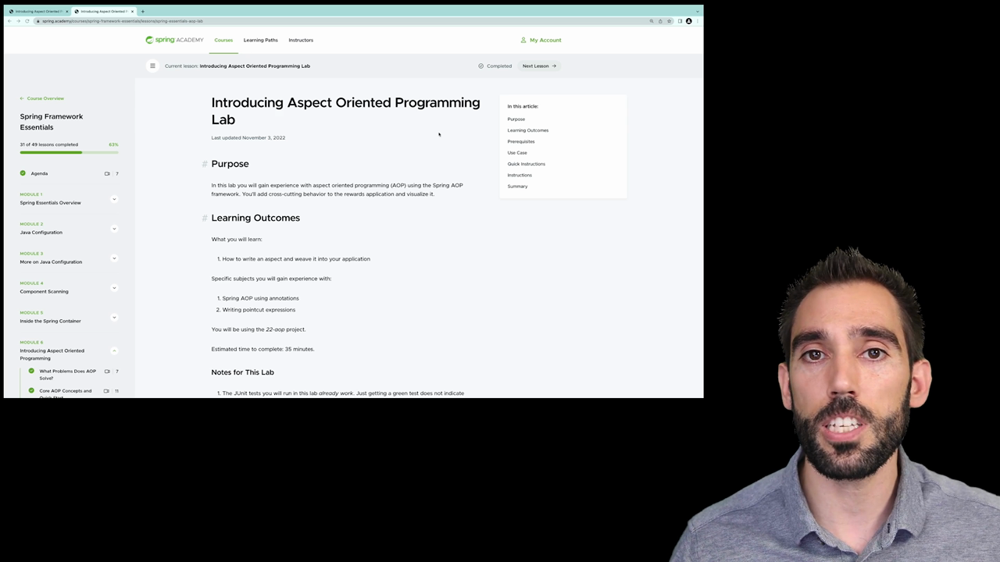
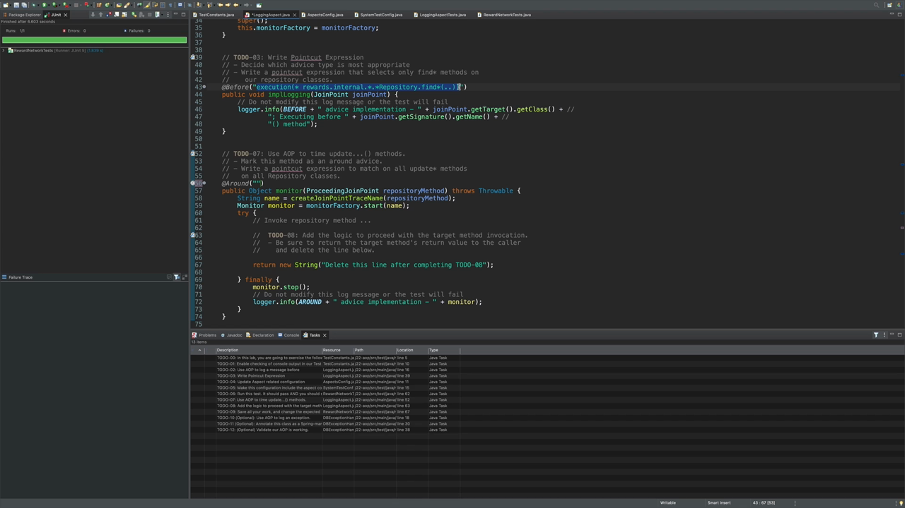

## What you'll get out of this lesson

This lesson walks through a hands-on lab that puts the AOP lessons into practice. By the end, you should be able to:

- Write your own `@Aspect` class from scratch and wire it into a Spring configuration
- Choose the right advice type for a given requirement and justify the choice
- Write AspectJ pointcut expressions that select methods by name pattern and by containing package
- Verify an aspect actually fired by checking both a test's green bar and its console output

## The scenario



Now that you know how to configure the application context, it's time to add behavior on top of your business logic. This lab uses Spring AOP to fulfill two requirements against the rewards application's repository classes:

1. **Create a simple logging aspect for repository "find" methods** — an advice that matches every method starting with `find` in the repositories and prints something to the console.
2. **Implement an advice that logs the time spent in each repository "update" method** — a second advice that times the execution of every matching update method.

As always, the lab is verified with tests — but in this lab specifically, a green bar alone isn't enough. The tests also check the actual console output, since that's the only way to confirm an aspect's side-effecting logic really ran.

The lab uses project **22-aop**, opened directly in the IDE, and is organized as a series of numbered to-dos.

## To-do 1: Enable console output checking

The first to-do is a small setup step: a flag that controls whether the test harness captures and checks console output gets switched to `true`. Without this, the tests could pass with a green bar even if the aspects silently did nothing.

## To-do 2: Create the logging aspect class and make it a Spring bean

The requirement is to log a message before any repository "find" method is invoked. The starting point is a plain class that already contains the logic to execute, but it isn't yet an aspect or a Spring bean.

Two annotations turn it into both:

- **`@Aspect`** — not a Spring annotation at all, but an AspectJ one (imported from `org.aspectj.lang.annotation.Aspect`). This is what marks the class as containing advice.
- **`@Component`** — this is what makes it a Spring-managed bean, so Spring notices the aspect exists and can apply it to the components it targets.

The class takes a `MonitorFactory` collaborator through its constructor — no `@Autowired` needed, since Spring can inject through a single constructor without the annotation.

## To-do 3: Write the pointcut expression for the "find" logging advice

Looking at the advice method's existing implementation, it logs a message — "before advice implementation," along with the target class and method name — into the console. Since this needs to happen *before* the method executes, before advice is the right choice here, so the method gets annotated with `@Before`.

The pointcut itself uses the `execution` designator. The repository classes live under `rewards.internal.account`, `rewards.internal.restaurant`, and `rewards.internal.rewards` — for example, `JdbcAccountRepository`, `JdbcRestaurantRepository`, and `JdbcRewardRepository`. The common pattern across all of them is that they live somewhere under `rewards.internal`, and their class names all end in `Repository`. Combining that with "any find method, with zero or more arguments" gives:

```java
@Before("execution(* rewards.internal.*.*Repository.find*(..))")
public void implLogging(JoinPoint joinPoint) {
    // Do not modify this log message or the test will fail
    logger.info("BEFORE" + " advice implementation - " + joinPoint.getTarget().getClass() +
        "; Executing before " + joinPoint.getSignature().getName() + "() method");
}
```

This matches any method starting with `find`, taking zero or more arguments, on any class ending in `Repository`, inside any sub-package of `rewards.internal`.

## To-do 4: Wire the aspect into the configuration

With the aspect implemented, it needs to actually be picked up. In a dedicated aspects configuration class:

- **Component scanning** is enabled, restricted specifically to the `rewards.internal.aspect` package — narrow enough to pick up just the aspects being built in this lab, without scanning everything else.
- **`@EnableAspectJAutoProxy`** is added at the class level. This is the annotation that tells Spring to actually create the AOP proxies at runtime. The lab is using Spring AOP's proxy-based weaving, not AspectJ's own compile-time or load-time weaving — `@EnableAspectJAutoProxy` is what activates that proxy creation.

That aspects configuration class then needs to be pulled into the application's main configuration — the one that already imports the data source and the rewards configuration — so that the full configuration imports every bean definition the application needs, aspects included.

## To-do 5: Run the first aspect test

With the wiring in place, the `LoggingAspectTest` (found under the test package, in the aspects area of the project) is run to confirm everything so far is correct. It produces a green bar, confirming the aspect, the pointcut, and the configuration are all wired together properly.

## To-do 6: Confirm the advice actually fires — twice

The next test calls a method on the reward network that, under the hood, calls two repository "find" methods: one to find an account by its credit card number, and one to find a restaurant by its merchant number. Since the logging aspect matches both, running this test should produce not just a green bar, but **two matching lines** in the console — one for each find call. Running it confirms both: the test passes, and the last two lines in the console are exactly the ones logged by the logging aspect.

## To-do 7: Add a second advice — this time, `@Around`

The second requirement is different in kind: instead of logging before a method runs, it needs to **time** how long each repository "update" method takes. That means running code both before and after the target — which calls for around advice rather than before advice.

The pointcut is structurally the same as the first aspect's, just matching `update*` methods instead of `find*` methods on the same repository classes.

## To-do 8: Implement the timing advice's logic

The implementation uses the injected `MonitorFactory` to start a timer, invoke the target, and then stop the timer — logging the elapsed time along the way. Because this is around advice, the advice method itself is responsible for delegating to the target and returning whatever the target returns:

```java
@Around("execution(* rewards.internal.*.*Repository.update*(..))")
public Object monitor(ProceedingJoinPoint repositoryMethod) throws Throwable {
    String name = createJoinPointTraceName(repositoryMethod);
    Monitor monitor = monitorFactory.start(name);
    try {
        // Invoke the repository method...
        return repositoryMethod.proceed();
    } finally {
        monitor.stop();
        // Do not modify this log message or the test will fail
        logger.info("AROUND" + " advice implementation - " + monitor);
    }
}
```

Calling `repositoryMethod.proceed()` inside the `try` block is what actually delegates to the target — its return value is passed straight back to the proxy as this advice method's own return value. The `finally` block stops the monitor and logs the timing message regardless of whether the target succeeded or threw, which also means the timer is stopped even on failure.



## To-do 9: Update the test's expected match count and re-verify

With two aspects now in play, the test's expected number of console matches changes from two to four: two lines from the "find" logging advice, and two more from the "update" timing advice. Looking again at the reward network method under test, it calls two find methods *and* two update methods, so four matching log lines are expected in total. Running the test produces the green bar plus all four expected lines — two from the before advice, two from the around advice.

## To-do 10 (optional): Add exception logging with `@AfterThrowing`

The optional section adds a third advice, this time to log exceptions thrown by repository methods. Since the goal is specifically to react to a thrown exception — not to run before or after regardless of outcome — this calls for `@AfterThrowing`.

The pointcut matches any method, with zero or more arguments, under `rewards.internal.*.*Repository` — deliberately not naming the exception type in the pointcut expression itself, since the fully qualified exception type would otherwise have to be embedded directly in the expression string. Instead, the exception type is expressed through a second annotation argument, `throwing`, matched against one of the advice method's own arguments by name:

```java
@AfterThrowing(value = "execution(* rewards.internal.*.*Repository.*(..))", throwing = "e")
public void logException(JoinPoint jp, DataAccessException e) {
    // ...log the exception...
}
```

Naming the argument this way does two things at once: it narrows the match so the advice only fires for that specific exception type (here, `DataAccessException`), and it gives the advice method access to the actual exception instance so it can be logged or otherwise processed.

## To-do 11: Make the exception-logging aspect a Spring bean

Component scanning was already enabled in an earlier to-do, but that alone doesn't make a class an aspect Spring recognizes — the new class also needs the `@Component` annotation, exactly as with the first aspect, so component scanning actually picks it up and Spring can apply it wherever it matches.

## To-do 12: Verify the exception-logging advice

The final to-do calls a method expected to throw an exception — specifically, a lookup by credit card number against an empty test database, which is expected to throw a `DataAccessException`. Because the after-throwing advice matches that exception type, running this test should produce the green bar *and* a warning line in the console coming from the exception-handling aspect's `logger.warn` call. Running it confirms both.

## Recap

- An `@Aspect`-annotated class becomes a Spring-managed aspect the moment it's also annotated `@Component` and picked up by component scanning — `@EnableAspectJAutoProxy` is what makes Spring actually build the proxies at runtime.
- Choosing an advice type is a matter of matching the requirement's shape: log something before a method runs → `@Before`; time or wrap an entire invocation → `@Around`; react to a specific exception type → `@AfterThrowing`.
- Pointcut expressions built with the `execution` designator can combine a package pattern, a class name pattern, and a method name pattern to precisely target a family of repository methods without hardcoding every class.
- `@Around` advice must call `proceed()` on the `ProceedingJoinPoint` and return its result — skipping that call means the target method never runs at all.
- `@AfterThrowing`'s `throwing` attribute narrows the match to a specific exception type and gives the advice access to the actual exception instance, the same way `@AfterReturning`'s `returning` attribute works for return values.
- Because these aspects have side effects (console output) rather than return values a test can easily assert on, verifying them means checking the console output directly, not just the test's pass/fail status.

## Check your understanding

1. Why does the pointcut expression `execution(* rewards.internal.*.*Repository.find*(..))` correctly match `JdbcAccountRepository`, `JdbcRestaurantRepository`, and `JdbcRewardRepository` without listing any of them by name?
2. In the timing advice, what would happen to the timer if the `monitor.stop()` call were placed inside the `try` block instead of the `finally` block, and the target method threw an exception?
3. Why can't the after-throwing advice's pointcut simply name `DataAccessException` directly inside the `execution(...)` expression string?

The next lesson moves into a new module: how to actually test Spring applications, starting with JUnit 5.
