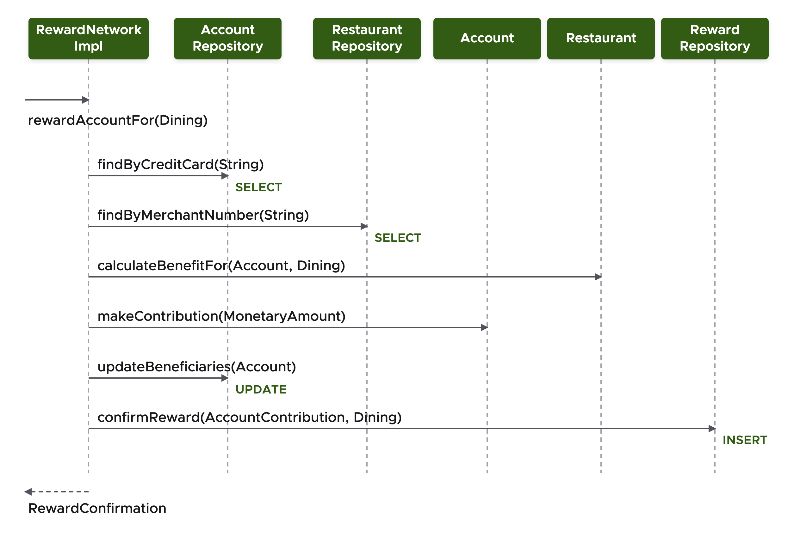
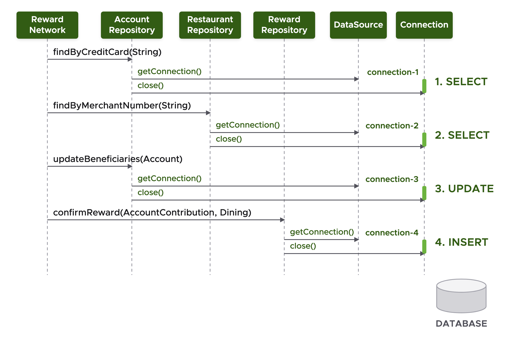
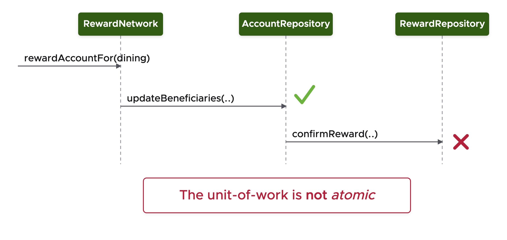
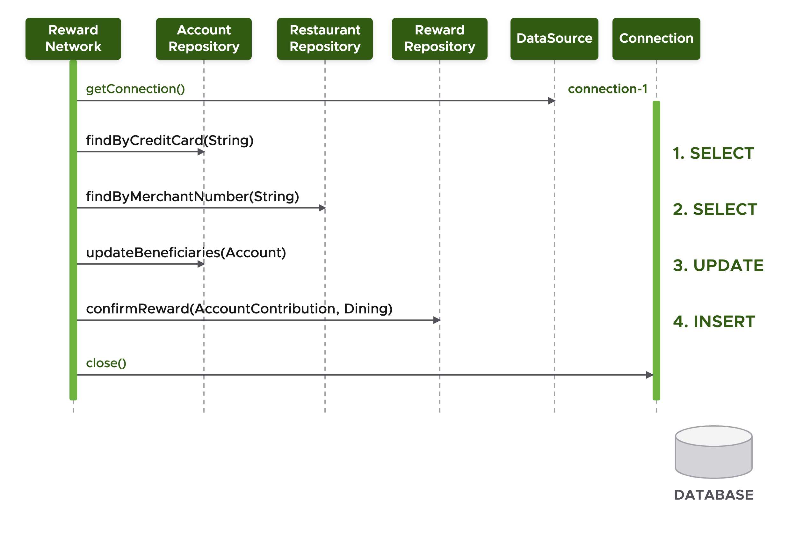

## What you'll get out of this lesson

By the end of this lesson, you should be able to:

- State the ACID properties and explain what each one guarantees
- Explain why running a multi-step operation without a transaction risks partial failures
- Trace what happens, connection by connection, when a unit of work runs non-transactionally versus within a transaction
- Recognize why Java has no single, common API for managing transactions across different technologies

## Why this module exists

This module opens a new topic: transaction management. The starting question is deliberately simple — why do we need transactions at all? — but it's worth answering carefully, because the answer motivates everything Spring does in the next few lessons.

Java gives you several different APIs that each know how to manage transactions in their own way — JDBC, JPA, and JMS all have their own answer. But there's no single, common API that spans all of them. That gap is exactly why it's worth letting Spring manage transactions on your behalf: you'll annotate your code to say *where* transactions should apply, and Spring takes care of *how* that actually happens underneath, regardless of which of those technologies you're using.

## The ACID properties

"Transaction" has a precise meaning, and it's worth grounding it in the classic ACID acronym:

- **Atomic** — a transaction is a unit of work; everything in it either commits or rolls back together. There's no partial outcome.
- **Consistent** — the data stays consistent with whatever integrity constraints the database defines; a transaction can never leave the data in a state that violates them.
- **Isolated** — transactions running concurrently don't interfere with or overlap each other.
- **Durable** — once a transaction commits, its changes are permanent, guaranteed to survive whatever happens next.

In short, a transaction exists to enable concurrent access to a shared resource without things going wrong in the process.

## A concrete example: rewarding an account

The course's running example, the `RewardNetwork` component, has a method called `rewardAccountFor(Dining)` that's a good illustration of a real unit of work. Calling it triggers a sequence of operations spread across several repositories:

- `findByCreditCard` on the account repository (a `SELECT`)
- `findByMerchantNumber` on the restaurant repository (a `SELECT`)
- `calculateBenefitFor`, a pure calculation with no database access
- `makeContribution`, `updateBeneficiaries` (an `UPDATE`)
- `confirmReward` (an `INSERT`)

That's a `SELECT`, another `SELECT`, an `UPDATE`, and an `INSERT`, all logically part of one operation: rewarding an account for a dining event. The question is what happens if none of this is wrapped in a transaction.

## Running non-transactionally

Without a transaction, every single repository method is independent. Each one acquires its own connection from the data source, does its work, and immediately releases that connection back — with no relationship between one method's connection and the next.

This shows up clearly across the four operations in the example: `findByCreditCard` gets `connection-1` and closes it; `findByMerchantNumber` gets `connection-2` and closes it; `updateBeneficiaries` gets `connection-3`; `confirmReward` gets `connection-4`. Four separate connections for what should conceptually be a single operation.

This is inefficient — repeatedly acquiring and releasing connections has real overhead — but the bigger problem is that **this is not atomic**. It is not a single, indivisible unit of work; it's several independent ones that happen to run back-to-back.

### Partial failures

That non-atomicity has a very real consequence: a **partial failure**. Suppose an account is being rewarded, and the beneficiaries are updated successfully — but the call to confirm the reward then fails.

The beneficiaries have already been updated and that change is already committed — there's no going back on it. But because the reward confirmation failed, there is now no record that the reward ever happened. The system is left in an inconsistent, half-finished state, and there's no way to know, after the fact, that anything went wrong. This is precisely the scenario ACID's atomicity guarantee exists to prevent, and it's exactly what happens when a multi-step operation isn't wrapped in a transaction.

## The correct approach: one connection, one unit of work

The fix is to run the whole operation within a single transaction, reusing one connection throughout:

- It's **more efficient** — the same connection is reused for every operation in the unit of work, instead of being opened and closed repeatedly.
- Operations **complete as an atomic unit** — either everything succeeds, or everything fails; there's no state where some of it happened and the rest didn't.
- The unit of work can run inside a **transaction**.

Here's the same sequence again, but running inside a transaction:

The connection is acquired once, at the very start — `connection-1` — and every subsequent call (`findByCreditCard`, `findByMerchantNumber`, `updateBeneficiaries`, `confirmReward`) reuses that exact same connection. The connection is only closed once, at the very end, after every step has completed. Because it's all one connection and one transaction, the database can guarantee the whole thing behaves as a single atomic operation: either every one of those `SELECT`, `UPDATE`, and `INSERT` statements takes effect, or none of them do.

## Recap

- A transaction is a set of tasks that behave as a single, indivisible action, guaranteed to be Atomic, Consistent, Isolated, and Durable (ACID).
- Java has multiple transaction-capable APIs (JDBC, JPA, JMS), but no single common API across all of them — which is the core motivation for letting Spring manage transactions instead.
- Without a transaction, each repository call gets and releases its own connection independently, which is both inefficient and non-atomic.
- Non-atomic operations are vulnerable to partial failures — some steps succeed and commit, others fail, and the result is inconsistent data with no record of what actually happened.
- Running a unit of work inside a transaction means acquiring one connection up front, reusing it for every step, and only releasing it once the entire unit of work has either fully succeeded or fully failed.

## Check your understanding

1. Which of the four ACID properties is violated specifically when a partial failure occurs, and why?
2. In the non-transactional version of `rewardAccountFor`, how many separate database connections get acquired across the four data-access calls, and why is that a problem beyond just atomicity?
3. Why doesn't Java provide one common API for transaction management across JDBC, JPA, and JMS?

Now that the "why" is established, the next lesson looks at exactly how Spring implements transaction management under the hood — starting with the `PlatformTransactionManager` and the `@Transactional` annotation.
