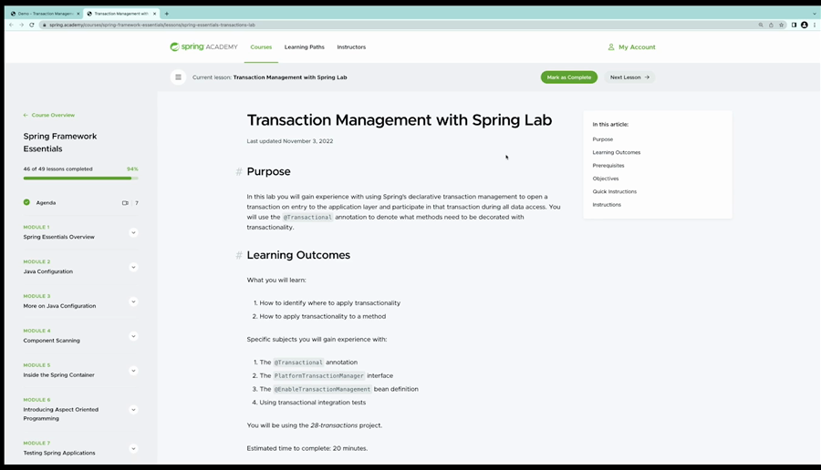
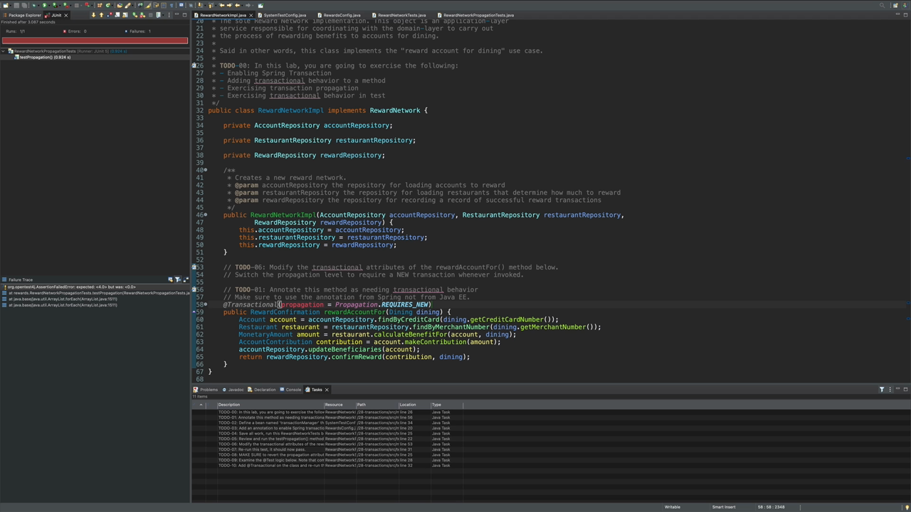

## What you'll get out of this lesson

This lesson walks through a hands-on lab that puts the transaction management lessons into practice. By the end, you should be able to:

- Add `@Transactional` to a method that needs to run as a single atomic unit of work
- Wire up a `PlatformTransactionManager` bean by hand, in plain Spring (no Spring Boot)
- Enable annotation-driven transaction management with `@EnableTransactionManagement`
- Confirm, from the log output, that multiple database calls inside a transactional method reuse a single connection
- Use `REQUIRES_NEW` to make a method's work commit independently of its caller
- Make a test class transactional so that repeated test runs don't leave behind data that breaks later assertions

## The starting point

Up to now, every call this course's `RewardNetworkImpl` class made to the database was independent — no atomicity, no guarantee that a `rewardAccountFor(...)` call that touches multiple tables would either fully succeed or fully fail together. This lab fixes that by adding real transaction management, using project **28 — transactions**.

As always, to-do 0 in the project sets the goals: enable transactions, add transactional behavior to a method, exercise different propagation levels, and use transactions inside tests.

## To-do 1: Annotate `rewardAccountFor` with `@Transactional`

`rewardAccountFor` on `RewardNetworkImpl` performs several selects, an update, and an insert — several separate interactions with the database that need to succeed or fail together. That makes it a natural candidate to be transactional.

There are two `@Transactional` annotations available on the classpath: a standard, framework-neutral one, and Spring's own. The lab specifically calls for **Spring's annotation**, because only it exposes the extra attributes covered in the "Configure Transaction Propagation" and "Setup Rollback Rules and Testing support" lessons — propagation, rollback rules, and whether the transaction is read-only.

## To-do 2: Define a transaction manager bean

Annotations are just metadata — something still has to actually start, commit, and roll back transactions. That something is a `PlatformTransactionManager`.

The lab adds a new bean to the configuration class, of type `PlatformTransactionManager`, named `transactionManager` as the instructions specify. For JDBC, the concrete implementation is `DataSourceTransactionManager`, which takes the existing `DataSource` bean already defined in the same configuration class as a constructor argument:

```java
@Bean
public PlatformTransactionManager transactionManager(DataSource dataSource) {
    return new DataSourceTransactionManager(dataSource);
}
```

## To-do 3: Enable annotation-driven transaction management

`@Transactional` is only a label until something processes it. `@EnableTransactionManagement`, added to the configuration class, is what tells Spring to scan for that annotation and register the post-processor responsible for wrapping annotated beans in proxies that add the actual transactional behavior — the same proxy mechanism discussed in the "Configure Transaction Propagation" lesson.

Worth noting: this project uses plain vanilla Spring, not Spring Boot. Defining the transaction manager bean and adding `@EnableTransactionManagement` are both steps a Spring Boot application would very likely get auto-configured for free. In plain Spring, they have to be added explicitly.

## To-do 4: Run the tests and check the connection log

With to-dos 1–3 done, the lab has the reward network tests run with debug logging turned on, specifically to inspect one detail: how many database connections get used during a single `rewardAccountFor` call.

Since `rewardAccountFor` now runs inside a transaction, every one of its several database interactions should reuse the *same* connection — acquired once, right before entering the transactional method, and released once, right after it finishes. Running the test produces a green bar, and the console log confirms exactly that: one connection acquired, one connection released, for the whole method.



## To-do 5: Watch a manual rollback take down committed work

The next to-do is a test method, `testPropagation`, that's already written and just needs running. It uses the transaction manager directly (manually, not through `@Transactional`) to:

1. Start a transaction.
2. Call `rewardAccountFor(...)`. Since that method's propagation is `REQUIRED` (the default), it simply joins the transaction the test already started rather than creating a new one.
3. Manually roll back the transaction.

Because `rewardAccountFor` never got its own, independent transaction, everything it did is rolled back along with the test's transaction. Running the test produces a red bar: the expected reward amounts (each beneficiary should have received $4) are never found in the database, because the whole thing was rolled back. This confirms, very concretely, what `REQUIRED` propagation actually means — the two pieces of work were never independent to begin with.

## To-do 6 and 7: Switch to `REQUIRES_NEW`, and watch the test pass

To fix this, the lab changes `rewardAccountFor`'s propagation to `REQUIRES_NEW`:



```java
@Transactional(propagation = Propagation.REQUIRES_NEW)
public RewardConfirmation rewardAccountFor(Dining d) {
    // ...
}
```

Rerunning the same `testPropagation` test now produces a green bar. The reasoning is the mirror image of the "Configure Transaction Propagation" lesson's propagation diagrams: the test still starts its own transaction, but `rewardAccountFor` now always starts a **new, independent** transaction of its own, regardless of the transaction the test started. That independent transaction commits on its own — so by the time the test manually rolls back *its* transaction, `rewardAccountFor`'s work was already safely committed and unaffected. Checking the database now finds the expected values, because that commit already happened.

## To-do 8: Revert the propagation change

Having proved the point, the lab has you revert `rewardAccountFor` back to the default propagation. Since `REQUIRED` is the default, the simplest way to do that is just to delete the `propagation` attribute entirely — omitting it is equivalent to specifying `REQUIRED`.

## To-do 9: A subtler problem — state leaking between tests

The next to-do highlights a different failure mode. Two test methods both call `rewardAccountFor` and assert that each beneficiary received $4. Individually, each test's logic is correct — but because `rewardAccountFor` now commits its own data (from the `REQUIRES_NEW` change still being effectively exercised by ordinary test execution, with no transactional rollback around the test itself), the first test's committed reward is still in the database when the second test runs. The second test's reward gets added on top, so the beneficiary now has $8, not $4 — and the second test's assertion fails.

Running the two tests confirms it: the first one passes, the second one fails with a red bar, purely because of leftover state committed by the first.

## To-do 10: Fix it with `@Transactional` at the class level

The fix is the testing pattern from the "Setup Rollback Rules and Testing support" lesson: add `@Transactional` (the Spring-specific annotation) at the test class level.

```java
@SpringJUnitConfig(RewardsConfig.class)
@Transactional
public class RewardNetworkTest {
    // ...
}
```

Now each test method starts its own transaction before running, delegates to `rewardAccountFor` (which joins that transaction, since its propagation is back to the default `REQUIRED`), and rolls that transaction back automatically once the test method finishes — regardless of whether the test passed. Rerunning both tests now produces a green bar for each: the first test's assertions pass and then get rolled back, so the second test starts from a clean slate and passes too. This is exactly the behavior the "Setup Rollback Rules and Testing support" lesson described — test transactions default to rolling back, specifically so that state never leaks from one test into the next.

## Recap

- `@Transactional` (Spring's own annotation, not the standard one) makes a method atomic and unlocks propagation, rollback, and read-only attributes.
- In plain Spring (without Spring Boot), you must explicitly define a `PlatformTransactionManager` bean (`DataSourceTransactionManager` for JDBC) and add `@EnableTransactionManagement` yourself.
- A transactional method that makes several database calls reuses a single connection — visible directly in the debug log as one acquire and one release.
- `REQUIRED` propagation means a manual rollback around a transactional method rolls back that method's work too, since they share one transaction; `REQUIRES_NEW` makes the method's transaction commit independently, immune to a later rollback of the caller's transaction.
- Without test-level transaction management, committed data from one test can leak into and break a later test that repeats the same logic.
- `@Transactional` at the test class level wraps every test method in its own transaction and rolls it back afterward, preventing that kind of state leakage between tests.

The next lesson closes out the course.
